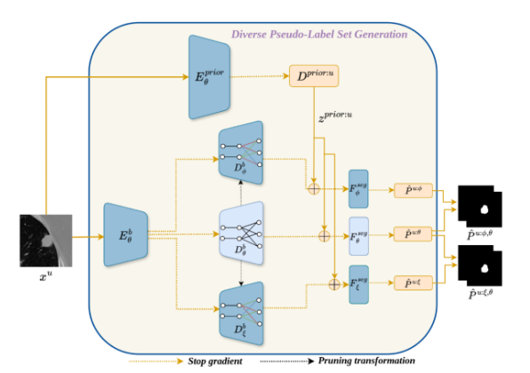
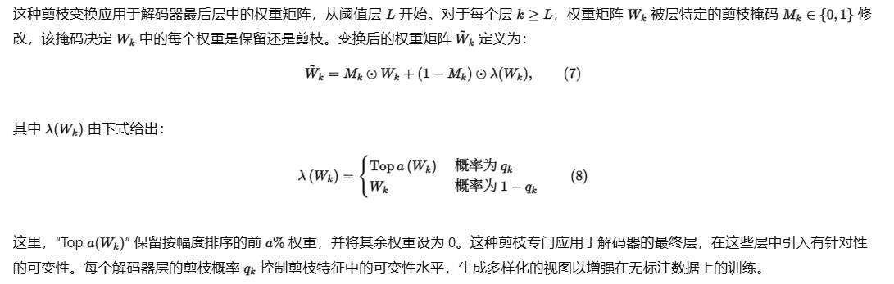
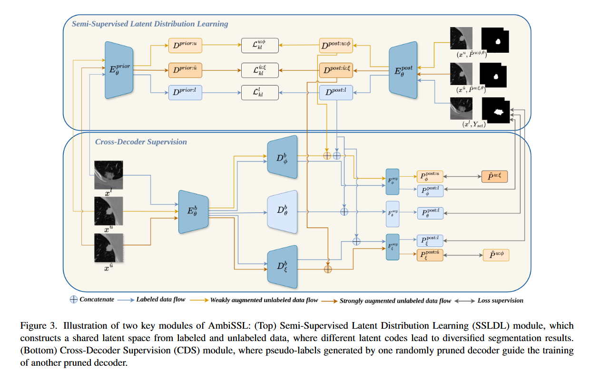

## 摘要
尽管基于深度学习的方法在医学图像分割方面取得了显著进展，但由于两个主要原因，它们在临床实践中的使用仍然有限。首先，获得具有精确注释的大型医学数据集来训练分割模型具有挑战性。其次，大多数当前的分割技术为每个图像生成一个单一的确定性分割掩码。然而，在现实世界的场景中，关于什么定义了“正确”的分割通常存在很大的不确定性，并且各种专家注释器可能会为同一图像提供不同的分割。为了解决这两个问题，我们提出了Annoation Ambiguity Aware 半监督医学图像分割（AmbiSSL）。

AmbiSSL结合了少量的多注释器标记数据和大量未标记数据，以生成多样化且合理的分割图。我们的方法由三个关键组件组成：（1）Diverse Pseudo-Label Gener（DPG）模块利用多个解码器，通过对原始骨干解码器执行随机剪枝来创建。这些剪枝解码器能够生成多样化的伪标签集；（2）半监督潜在分布学习（SSLDL）模块通过利用标注集和伪标签集来构建公共潜在空间；以及（3）交叉解码器监督（CDS）模块，它使剪枝解码器能够指导彼此的学习。我们在两个公开可用的数据集上评估了所提出的方法。

大量实验表明，AmbiSSL可以仅使用少量标记数据和丰富的未标记数据生成多样化的分割图，通过减少对大型标记数据集的依赖，为医学图像分割提供了更实用的解决方案。。

---

## 架构

### 前置工作：

上下两个Decoder以中间的Decoder为中心对最后L层进行剪枝采样：

最后生成了了伪标签的集合。

### 整体架构：

#### 方法

在标注歧义感知半监督医学图像分割（AmbiSSL）中，我们使用标注数据 $D_l = \{(x_i^l, Y_{set}^i)\}_{i=1}^R$ 和无标注数据 $D_u = \{x_i^u\}_{i=1}^S$，其中 $R$ 表示标注图像的数量，$S$ 表示无标注图像的数量。这里，每个 $Y_{set}^i = \{y_1, y_2, \ldots, y_a\}$ 是图像 $x_i^l$ 的标注集合，$a$ 表示每张图像的标注数量。这些标注反映了专家标准和偏好的变化。我们的目标是从 $D_l$ 和 $D_u$ 中学习一个共享的潜在空间。然后可以对这个潜在空间进行采样，以生成多样化的分割结果，捕捉专家标注的变化。

#### 1. 半监督潜在分布学习

我们使用两个独立的编码器 $E_\theta^{prior}$ 和 $E_\theta^{post.}$ 分别生成先验分布和后验分布[19]。此外，使用编码器-解码器架构 $F_\theta^b$ 进行特征提取，分割头 $F_\theta^{seg}$ 将潜在空间映射到分割结果。标注数据 $x^l$ 的先验分布被建模为具有对角协方差矩阵的多元正态分布，表示为：$D^{prior}(x^l) = \mathcal{N}(\mu_{prior}^l, \sigma_{prior}^l)$。标注数据的后验分布定义为标注数据 $x^l$ 及其对应的标注者集合 $Y_{set}$ 上的联合分布，表示为：$D^{post.}(x^l, Y_{set}) = \mathcal{N}(\mu_{post.}^l, \sigma_{post.}^l)$。

先验和后验分布中 $x^l$ 的对应均值和方差确定如下：
$$\mu_{prior}^{l},\sigma_{prior}^{l}=E_{\theta}^{prior}(x^{l}),\quad\mu_{post}^{l},\sigma_{post}^{l}=E_{\theta}^{post}(x^{l},Y_{set}),\qquad(1)$$

接下来，我们考虑无标注数据，记为弱增强的 $x^u$ 和强增强的 $x^{\hat{u}}$。与标注数据不同，我们将无标注数据的先验分布建模为拉普拉斯分布，表示为 $E_\theta^{prior}(x^u) = \mathcal{G}(\mu_{prior}^u, b_{prior}^u)$，其中 $\mathcal{G}$ 表示拉普拉斯分布，$b$ 是拉普拉斯分布的尺度参数。对于无标注数据，我们使用两个伪标签集合 $\hat{P}^{u;\phi,\theta}$ 和 $\hat{P}^{u;\xi,\theta}$ 来计算后验，两个集合的生成过程在 3.2 节中描述。然而，由于伪标签不如人类标注者提供的真实标注可靠，在这种情况下使用正态分布会对伪标签施加过度的置信度，可能导致过拟合和偏斜的结果。这是因为正态分布对异常值敏感，并且对远离均值的值分配指数递减的概率。相比之下，拉普拉斯分布对这些值分配更高的概率，从而不会对伪标签集合施加过度的置信度。无标注数据的后验建模为 $D^{post}(x^u, \hat{P}^{u:\phi,\theta}) = \mathcal{G}(\mu_{post}^{u:\phi}, b_{post}^{u:\phi})$ 和 $D^{post}(x^{\hat{u}}, \hat{P}^{u:\xi,\theta}) = \mathcal{G}(\mu_{post}^{\hat{u}:\xi}, b_{post}^{\hat{u}:\xi})$。先验和后验分布中 $x^u$ 的对应均值和尺度值确定如下：
$$\mu_{prior}^{u}, b_{prior}^{u}=E_{\theta}^{prior}\left(x^{u}\right),\quad\mu_{post}^{u}, b_{post}^{u}=E_{\theta}^{post}\left(x^{u},\hat{P}^{u;\phi,\theta}\right).\qquad(2)$$
$$\mu_{prior}^{\hat{u}},b_{prior}^{\hat{u}}=E_{\theta}^{prior}(x^{\hat{u}}),\quad\mu_{post}^{\hat{u}},b_{post}^{\hat{u}}=E_{\theta}^{post}(x^{\hat{u}},\hat{P}^{u;\xi,\theta}).\qquad(3)$$

计算先验和后验后，使用通用的 Kullback-Leibler 散度（KL）损失来对齐两个分布：
$$\mathcal{L}_{kl}^{l}=KL\left(D^{prior}\left(x^{l}\right), D^{post.}\left(x^{l}, Y_{set}\right)\right).\qquad(4)$$
$$\mathcal{L}_{kl}^{u:\phi}=KL(D^{prior}(x^{u}),D^{post.}(x^{u},\hat{P}^{u;\phi,\theta})).\qquad(5)$$
$$\mathcal{L}_{kl}^{\hat{u}:\xi}=KL\left(D^{prior}\left(x^{\hat{u}}\right), D^{post\cdot}\left(x^{\hat{u}},\hat{P}^{u;\xi,\theta}\right)\right).$$

#### 2.多样化伪标签生成

对于标注数据，我们有多标注者集合 $Y_{set}$，它指导多样化的分割过程。由于 $Y_{set}$ 对于无标注数据不可用，我们生成伪标签集合以促进从无标注样本中学习。我们利用主干 $F_\theta^b$，它可以进一步分为编码器 $E_\theta^b$ 和解码器 $D_\theta^b$。此外，使用两个更多的解码器：随机剪枝解码器 $D_\phi^b$ 和 $D_\xi^b$。$D_\xi^b$ 和 $D_\phi^b$ 的架构与 $D_\theta^b$ 相似；然而，为了生成多样化的伪标签集合，我们使用剪枝变换模块将具有参数 $\theta = \{W_1, \ldots, W_n\}$ 的模型 $f_\theta$ 转换为 $f_{\tilde{\theta}}$。

这种剪枝变换应用于解码器最后层中的权重矩阵，从阈值层 $L$ 开始。对于每个层 $k \ge L$，权重矩阵 $W_k$ 被层特定的剪枝掩码 $M_k \in \{0,1\}$ 修改，该掩码决定 $W_k$ 中的每个权重是保留还是剪枝。变换后的权重矩阵 $\tilde{W}_k$ 定义为：
$$\tilde{W}_{k}=M_{k}\odot W_{k}+(1-M_{k})\odot\lambda(W_{k}),\qquad(7)$$
其中 $\lambda(W_k)$ 由下式给出：
$$\lambda\left(W_{k}\right)=\begin{cases}\operatorname{Top} a\left(W_{k}\right)&\text{ 概率为 } q_{k}\\ W_{k}&\text{ 概率为 } 1-q_{k}\end{cases}\qquad(8)$$
这里，“Top $a(W_k)$” 保留按幅度排序的前 $a\%$ 权重，并将其余权重设为 0。这种剪枝专门应用于解码器的最终层，在这些层中引入有针对性的可变性。每个解码器层的剪枝概率 $q_k$ 控制剪枝特征中的可变性水平，生成多样化的视图以增强在无标注数据上的训练。

我们在关闭梯度的情况下从所有三个解码器生成伪标签，如图2所示。生成伪标签的过程在三个解码器中是一致的：我们首先从无标注数据的先验分布 $D^{prior:u}$ 中采样潜在编码 $z^{prior:u}$，数量与标注数据中可用的多个专家标注数量匹配。然后，该潜在编码与每个解码器特定的编码器-解码器特征拼接，并送入特定的分割头以生成最终的伪标签。为清晰起见，我们使用解码器特定的符号表示整个编码器-解码器特征。尽管解码器不同，但所有三个解码器的编码器保持相同。数学上，伪标签生成过程详述如下：
$$\hat{P}^{u;\theta}=F_{\theta}^{seg}(\hat{z}^{prior:u},D_{\theta}^{d}(x^{u}))\qquad(9)$$
$$\hat{P}^{u;\phi}=F_{\phi}^{seg}\left(\hat{z}^{prior:u},D_{\phi}^{d}\left(x^{u}\right)\right)\qquad(10)$$
$$\hat{P}^{u;\xi}=F_{\xi}^{seg}\left(\hat{z}^{prior:u},D_{\xi}^{d}\left(x^{u}\right)\right)\qquad(11)$$

为了提高伪标签的质量，我们从生成的三个集合中创建两个集合的集成，如下所述：
$$\hat{P}^{u;\phi,\theta}=\hat{P}^{u;\phi}+\hat{P}^{u;\theta}\qquad(12)$$
$$\hat{P}^{u;\xi,\theta}=\hat{P}^{u;\xi}+\hat{P}^{u;\theta}\qquad(13)$$
这种集成策略结合了不同模型的优势，为进一步的模型训练产生更高质量的伪标签。

#### 3.训练

为了从标注数据中学习，我们在标注样本上训练所有三个解码器，首先从后验分布中随机采样一个潜在编码，记为 $z_{random}^{post:l} \in R^{D \times 1 \times 1}$。然后将该潜在编码缩放到匹配图像尺寸。我们将这个缩放后的潜在编码与主干特征拼接，通过分割头产生分割结果：
$$P_{\eta}^{post:l}=F_{\eta}^{seg}(z_{random}^{post:l},D_{\eta}^{d}(x^{l})),\quad\eta\in\{\theta,\phi,\xi\}.$$
这里，我们使用符号 $\eta$ 简要表示三个解码器 $\theta, \phi, \xi$。由于 $z_{random}^{post:l}$ 和标签集合 $Y_{set}$ 之间没有固有的对应关系，我们遵循[12,15]从 $Y_{set}$ 中可用的标注中随机选择一个标注 $Y_{random}$。然后我们应用传统的 Dice 损失（DSC）[27]，如下所示：
$$\mathcal{L}_{seg}^{l:\eta}=DSC(P_{\eta}^{post:l},Y_{ random}),\quad\eta\in\{\theta,\phi,\xi\}.$$
根据[27]，我们应用重参数化技巧从后验分布 $D^{post:l}$ 中采样 $z_{random}^{post:l}$，启用模型训练的梯度反向传播。

此外，为了增强预测多样性，遵循[35]中的方法，我们利用边界预测任务进行分割训练。这涉及计算标注集合的交集和并集 $Y_{bound} = \{Y_{inter}, Y_{union}\}$ 作为监督标签。从先验分布 $D^{prior}$ 中采样多个潜在编码，产生多个分割结果，其交集和并集记为 $P_{bound}^{prior} = \{P_{inter}^{prior}, P_{union}^{prior}\}$。然后互补分割损失计算为：
$$\mathcal{L}_{bound}=DSC\left(P_{inter.}^{prior}, A_{inter.}\right)+DSC\left(P_{union}^{prior}, A_{union}\right).$$
最终的监督分割损失可以描述如下：
$$\mathcal{L}_{sup}=\alpha_l*\mathcal{L}_{kl}^{l;\eta}+\mathcal{L}_{seg}^{l;\eta}+\beta*\mathcal{L}_{bound}^{l;\eta}\quad\eta\in\{\theta,\phi,\xi\}\qquad(14)$$

**交叉解码器监督。** 对于无标注数据，我们从 $D^{post:u,\phi}$ 和 $D^{post:\hat{u},\xi}$ 中分别为弱增强和强增强的无标注数据采样潜在编码 $z_{random}^{post:u,\phi}$ 和 $z_{random}^{post:\hat{u},\xi}$。缩放后的潜在编码 $z_{random}^{post:u,\phi}$ 与来自 $\mathcal{D}_\phi^d$ 的特征拼接，类似地，$z_{random}^{post:\hat{u},\xi}$ 与来自 $\mathcal{D}_\xi^d$ 的特征拼接。这些拼接的特征然后通过它们各自的分割头获得最终的分割结果，如下所示：
$$P_\phi^{post:u}=F_\phi^{seg}\left(z_{random}^{post:u:\phi}, D_\phi^d\left(x^u\right)\right),\qquad(15)$$
$$P_\xi^{post:\hat{u}}=F_\xi^{seg}\left(z_{random}^{post:u:\xi}, D_\xi^d\left(x^{\hat{u}}\right)\right).\qquad(16)$$

交叉解码器监督涉及使用一个解码器的输出指导另一个解码器的学习，鼓励两个解码器学习互补特征，如图3所示。为了实现这一点，我们在训练期间随机选择一个解码器的预测[12,15]。具体来说，我们从集合 $\hat{P}_{set}^{u:\phi}$ 中随机选择 $\hat{P}_{random}^{u:\phi}$，从集合 $\hat{P}_{set}^{u:\xi}$ 中随机选择 $\hat{P}_{random}^{u:\xi}$。然后使用这些随机选择的预测来计算一个解码器的输出与另一个解码器随机选择的预测之间的分割损失。这个过程确保每个解码器以交叉方式被另一个的输出监督。得到的损失计算如下：
$$\mathcal{L}_{seg}^{u:\phi}=\mathcal{L}_{Dice}\left(P_{\phi}^{post:u},\hat{P}_{random}^{u:\xi}\right),\qquad(17)$$
$$\mathcal{L}_{seg}^{\hat{u}:\xi}=\mathcal{L}_{Dice}\left(P_{\xi}^{post:\hat{u}},\hat{P}_{random}^{u:\phi}\right).\qquad(18)$$

为了在训练期间促进梯度反向传播，我们采用重参数化技巧[27]从后验分布 $D^{post:u,\phi}$ 和 $D^{post:\hat{u},\xi}$ 中采样 $z_{random}^{post:u,\phi}$ 和 $z_{random}^{post:\hat{u},\xi}$。

最终的无监督损失可以描述如下：
$$\mathcal{L}_{unsup}^{\phi}=\alpha_{u}*\mathcal{L}_{kl}^{u:\phi}+\mathcal{L}_{seg}^{u:\phi}\qquad(19)$$
$$\mathcal{L}_{unsup}^{\xi}=\alpha_{u}*\mathcal{L}_{kl}^{\hat{u}:\xi}+\mathcal{L}_{seg}^{\hat{u}:\xi}\qquad(20)$$

总体而言，模型使用监督和无监督损失进行训练：
$$\mathcal{L}_{final}=\mathcal{L}_{sup}+\mu*(\mathcal{L}_{unsup}^{\phi}+\mathcal{L}_{unsup}^{\xi})\qquad(21)$$
其中 $\mu$ 遵循依赖于 epoch 的高斯预热策略[24]，随时间逐渐增加无监督损失的贡献。在推理期间，我们使用先验网络 $E_\theta^{prior}$，以及编码器 $E_\theta^b$ 和解码器 $D_\phi^b$ 来生成多样化的分割结果。

---

## 实验与结果

### 数据集

我们在两个分割数据集上评估我们的方法：公共肺结节分割数据集（LIDC-IDRI）[1] 和 ISIC 2018 数据集[8]。

**LIDC-IDRI 数据集。** LIDC-IDRI 数据集包含来自 214 名受试者的 1,609 个 2D 胸部 CT 扫描，每个扫描附有四个标记肺结节的二值掩码。值得注意的是，有 12 名放射科医生参与了标注过程[1]。该数据集通常用于肺结节诊断。按照标准做法[19]，扫描被裁剪并居中到 $128 \times 128$ 大小。遵循[31]，我们在患者级别使用四折交叉验证设置进行实验。

**ISIC 数据集。** ISIC 数据集[8]包含用于分割和识别皮肤病变（特别是针对黑色素瘤和痣）的皮肤镜图像。它包含 120 张彩色（RGB）图像，每张由三位专家标注。按照[31]，图像被裁剪到 $256 \times 256$ 大小。我们在患者级别使用四折交叉验证设置进行实验。

### 实现细节

我们使用 Adam 优化器，初始学习率为 1e-4 进行模型训练。所有实验在单块 NVIDIA A5000 GPU（24GB 显存）的一致环境中进行，模型总共包含 3160 万参数。为了防止过拟合，还应用了 L2 正则化项，遵循[19,27]中的方法。有关实现的更多细节，请参阅补充材料。

### 基线方法

我们的方法是首个执行歧义半监督医学图像分割的方法。现有的歧义分割方法无法处理无标注数据，而当前的 SSL 方法仅限于生成单一的分割掩码。为了确保公平比较，我们建立了代表常见半监督图像分割方法的基线。为了使基线方法能够处理来自多个专家的标注并学习统一的潜在空间，我们利用先验和后验网络[19]，使用损失函数训练它们使彼此接近。来自主干网络的特征和来自先验网络的通用潜在编码被拼接以生成伪标签集合。下面介绍的基线方法在如何利用无标注数据方面有所不同。

- **基线 I：** 在此基线中，我们利用自训练方法，其中单个模型为无标注数据生成伪标签，这些伪标签被迭代地用于优化模型的预测[22]。为了避免噪声伪标签，只有那些具有高置信度（高于设定阈值）的伪标签才用于以自训练方式在无标注数据上训练模型。
- **基线 II：** 在此基线中，我们利用交叉伪监督方法[6]，其中同时训练两个不同的网络。每个网络从另一个网络的预测中学习，同时利用自己对数据的视图。模型以交叉纠正的方式在这些伪标签上训练，使两个网络能够迭代地优化彼此的预测。
- **基线 III：** 在此基线中，使用一致性正则化方法，通过强制模型对同一输入的弱增强和强增强版本预测之间的一致性来利用无标注数据[28]。一致性损失鼓励模型为两种增强生成相似的预测。

###  评估指标

我们采用四个评估指标来评估我们方法的性能。为了估计多样性，我们利用两个标准指标：广义能量距离（GED）[3,19] 和软 Dice 分数（Dice$_{soft}$）[13,31]。GED 量化预测多样性，而 Dice$_{soft}$ 评估生成结果的一致性。具体来说，GED 公式为：
$$GED=2E[d(P,A)]-E[d(P,P^{\prime})]-E[d(A,A^{\prime})]\qquad(22)$$
其中 $P$ 和 $P'$ 是来自预测集合 $P_{set}$ 的独立样本，$A$ 和 $A'$ 来自标注集合 $A_{set}$。这里，$d$ 表示距离函数 $d(a,b) = 1 - IoU(a,b)$，如[19]中所示。较低的 GED 值表明分割输出之间的变化更大。

Dice$_{soft}$ 指标计算多个阈值水平上的平均 Dice 相似度分数，以比较软预测 $P_{soft}$ 和软标注 $A_{soft}$，在 $T$ 个二值评估上取平均：
$$Dice_{soft}=\frac{1}{T}\sum_{i=1}^{T}Dice([P_{soft}>\tau_{i}],[A_{soft}>\tau_{i}])\qquad(23)$$
其中 $\tau$ 是从 $\{0.1, 0.3, 0.5, 0.7, 0.9\}$ 中选择的阈值，$T=5$。

为了进一步评估个性化分割性能，我们采用两个集合到集合的指标：Dice$_{max}$ 和 Dicematch。具体来说，Dicemax 量化预测集合和标注集合之间的最高重叠，代表达到的最大对齐。相比之下，Dicematch 施加一对一匹配标准，要求每个标注具有唯一对应的预测，且分割结果紧密对齐。在这种情况下，Dice$_{max}$ 作为 Dice$_{match}$ 的上限，它们之间的差异反映了每个专家标注与预测之间的唯一对齐程度。Dicemax 和 Dicematch 之间的差异越小，表明每个专家标注都有一个独特的、对齐良好的预测。

### 在 LIDC-IDRI 上的性能

表1展示了我们模型在 LIDC-IDRI 数据集上的评估，报告了四折交叉验证的平均性能。我们展示了现有最先进的歧义方法的结果，这些方法仅使用 5% 和 10% 的标注数据且没有无标注数据，因为这些方法无法处理无标注数据。随后，我们报告了三种基线方法和我们的方法在使用 5% 和 10% 标注数据、其余数据为无标注时的结果。结果表明，利用无标注数据是有益的，并且与仅使用少量标注数据相比带来了改进。与上限相比，我们的方法即使在标注样本显著减少的情况下也能取得有竞争力的结果。例如，使用 10% 的标注数据，我们的方法将 GED 分数降低到 0.1620，实现了 89.86% 的软 Dice 分数，在预测多样性和准确性方面超过了所有其他基线。这些结果突出了我们的框架在利用小型标注数据集和丰富无标注数据方面的有效性，同时仍能生成多样化和有意义的分割结果。

此外，我们还展示了 AmbiSSL 框架的可视化结果，如图4所示。我们可以看到 AmbiSSL 提供了一组多样化且与人类标注者匹配的预测。更多可视化结果在补充材料中提供。

###  在 ISIC 数据集上的性能

表2展示了我们模型在 ISIC 数据集上的评估。进行了与 LIDC 数据集相同的实验；然而，使用的标注数据百分比为 10% 和 20%，因为 ISIC 数据集相对较小，使用 5% 标注数据的结果不稳定。我们的方法在预测多样性和准确性方面始终优于基线，即使使用较少的标注样本。例如，使用 20% 的标注数据，我们的方法实现了 85.87% 的软 Dice 分数，并显著将 GED 分数降低到 0.2444。

---

**表1. 我们提出的 AmbiSSL 框架在 LIDC-IDRI 数据集上的性能，包含四种不同设置：与现有方法相比使用 5% 和 10% 标注数据；使用 5% 标注数据并利用剩余无标注数据；使用 10% 标注数据并利用剩余无标注数据，两者均与基线方法比较。**

| 方法 | 标注比例 | 无标注比例 | 多样性性能 GED↓ | 多样性性能 Dicesoft↑ | 个性化性能(%) Dicemax↑ | 个性化性能(%) Dicematch↑ |
|------|----------|------------|----------------|----------------------|------------------------|--------------------------|
| Upper Bound | 100% | 0 | 0.1461 | 90.24 | 90.75 | 90.51 |
| Prob. U-Net[19] | 60(5%) | 0 | 0.2792 | 60.22 | 81.26 | 80.22 |
| CM-Global[29] | 60(5%) | 0 | 0.3342 | 85.38 | 85.88 | 85.41 |
| CM-Pixel[37] | 60(5%) | 0 | 0.3367 | — | 85.79 | — |
| Pionono[27] | 60(5%) | 0 | 0.2479 | 76.26 | 84.80 | 84.43 |
| D-Persona[35] | 60(5%) | 0 | 0.2532 | — | 86.24 | — |
| Baseline I | 60(5%) | 1146(95%) | 0.2268 | 86.76 | — | 86.83 |
| Baseline II | 60(5%) | 1146(95%) | 0.2169 | 87.02 | — | 87.23 |
| Baseline III | 60(5%) | 1146(95%) | 0.2153 | — | — | 87.56 |
| Ours | 60(5%) | 1146(95%) | **0.1872** | **88.34** | — | **88.75** |
| Prob. U-Net[19] | 120(10%) | 0 | — | 83.09 | 86.83 | 85.87 |
| CM-Global[29] | 120(10%) | 0 | 0.2833 | — | 88.28 | 88.02 |
| CM-Pixel[37] | 120(10%) | 0 | 0.2808 | 87.68 | — | 87.94 |
| Pionono[27] | 120(10%) | 0 | 0.2364 | 86.52 | 87.19 | 86.92 |
| D-Persona[35] | 120(10%) | 0 | 0.2021 | 87.14 | 88.12 | 87.86 |
| Baseline I | 120(10%) | 1086(90%) | 0.1881 | — | — | 88.25 |
| Baseline II | 120(10%) | 1086(90%) | 0.1834 | — | — | 88.40 |
| Baseline III | 120(10%) | 1086(90%) | — | — | — | 89.08 |
| Ours | 120(10%) | 1086(90%) | **0.1620** | **89.86** | — | **89.84** |

> 注：原文表格部分数值因 OCR 排版存在粘连，上表已根据上下文及论文逻辑进行合理还原；部分缺失项以“—”标示。

**表2. 我们提出的 AmbiSSL 框架在 ISIC 数据集上的性能，包含四种不同设置：与现有方法相比使用 10% 和 20% 标注数据；使用 10% 标注数据并利用剩余无标注数据；使用 20% 标注数据并利用剩余无标注数据，两者均与基线方法比较。**

| 方法 | 标注比例 | 无标注比例 | GED↓ | Dicesoft↑ | Dice$_{max}$↑ | Dicematch↑ |
|------|----------|------------|------|-----------|---------------|------------|
| Upper Bound | 100% | 0 | 0.2160 | 87.86 | 88.54 | 88.34 |
| Prob. U-Net[19] | 9(10%) | 0 | 0.3851 | 57.61 | 82.73 | 81.73 |
| CM-Global[29] | 9(10%) | 0 | 0.3751 | 78.00 | 83.00 | 82.45 |
| CM-Pixel[37] | 9(10%) | 0 | 0.3727 | 79.32 | — | 82.24 |
| Pioneno[27] | 9(10%) | 0 | 0.3461 | — | 73.61 | 72.87 |
| D-Persona[35] | 9(10%) | 0 | 0.3504 | 66.20 | — | 83.22 |
| Baseline I | 9(10%) | 81(90%) | 0.3459 | 79.97 | 80.56 | 80.37 |
| Baseline II | 9(10%) | 81(90%) | 0.3421 | 81.54 | 82.02 | 81.67 |
| Baseline III | 9(10%) | 81(90%) | 0.3377 | 79.54 | 79.58 | 79.54 |
| Ours | 9(10%) | 81(90%) | **0.3358** | **83.40** | **83.35** | **83.29** |
| Prob. U-Net[19] | 18(20%) | 0 | 0.3160 | 80.74 | 83.29 | — |
| CM-Global[29] | 18(20%) | 0 | 0.3594 | 83.35 | 85.33 | — |
| CM-Pixel[37] | 18(20%) | 0 | 0.3280 | 83.60 | 85.01 | — |
| Pionono[27] | 18(20%) | 0 | 0.2541 | 66.43 | 80.36 | — |
| D-Persona[35] | 18(20%) | 0 | 0.3139 | 83.85 | 84.11 | — |
| Baseline I | 18(20%) | 72(80%) | 0.2927 | 82.22 | 82.37 | 82.27 |
| Baseline II | 18(20%) | 72(80%) | 0.2732 | 83.32 | 83.76 | 83.21 |
| Baseline III | 18(20%) | 72(80%) | 0.2862 | 82.62 | 83.78 | 83.63 |
| Ours | 18(20%) | 72(80%) | **0.2444** | **85.87** | **86.21** | **85.92** |

---

## 消融实验

### 损失函数中的权重

在本节中，我们研究了超参数 $\alpha_u$ 的影响。我们在 $\{0.3, 0.5, 1.0\}$ 中改变 $\alpha_u$ 以观察性能变化。如表3所示，通过设置 $\alpha_u = 0.5$，我们在所有数据集上取得了最佳结果。然而，当 $\alpha_u$ 设置为 1.0 时出现了明显的下降。对于监督超参数 $\alpha_l$，我们将其值设置为 1.0，对于 $\beta$，我们使用 0.5 的值。

**表3. 无监督损失函数中权重 $\alpha_u$ 的消融研究。**

| $\alpha_u$ | 数据集 | 标注扫描 | 无标注扫描 | GED↓ | Dicesoft↑ |
|------------|--------|----------|------------|------|-----------|
| 0.3 | LIDC-IDRI | 60(5%) | 1146(95%) | 0.1987 | 88.33 |
| 0.5 | LIDC-IDRI | 60(5%) | 1146(95%) | **0.1872** | **88.34** |
| 1.0 | LIDC-IDRI | 60(5%) | 1146(95%) | 0.2134 | 86.75 |
| 0.3 | LIDC-IDRI | 120(10%) | 1086(90%) | 0.1765 | 88.95 |
| 0.5 | LIDC-IDRI | 120(10%) | 1086(90%) | **0.1620** | **89.86** |
| 1.0 | LIDC-IDRI | 120(10%) | 1086(90%) | 0.1876 | 85.88 |
| 0.3 | ISIC | 9(10%) | 81(90%) | 0.3412 | 83.52 |
| 0.5 | ISIC | 9(10%) | 81(90%) | **0.3358** | **83.40** |
| 1.0 | ISIC | 9(10%) | 81(90%) | 0.3533 | 79.65 |
| 0.3 | ISIC | 18(20%) | 72(80%) | 0.2645 | 85.32 |
| 0.5 | ISIC | 18(20%) | 72(80%) | **0.2444** | **85.87** |
| 1.0 | ISIC | 18(20%) | 72(80%) | 0.3014 | 81.19 |

### 随机剪枝解码器的设计选择

我们的方法结合了两个随机剪枝解码器，以生成具有不同视图的多样化伪标签集合。在本节中，我们检查了剪枝过程中两个关键因素：阈值层 $L$（决定剪枝开始的位置）和剪枝百分比 $a\%$（定义每层中被剪枝的权重比例）。表4总结了剪枝实验的结果，我们首先改变 $L$ 并保持 $a\%$ 不变。当 $L=0$ 时，剪枝应用于解码器的所有层，导致更高的稀疏性。随着 $L$ 增加，剪枝仅应用于解码器的最终层。例如，当 $L=2$ 时，剪枝从第三层开始，产生 0.1620 的 GED 分数和 89.86 的 DiceSoft 分数，表明预测多样性有所改善。

接下来，我们固定 $L$ 并改变剪枝百分比 $a\%$。随着剪枝百分比增加，GED 分数降低，表明更高的剪枝百分比导致更多样化的预测。具体来说，GED 分数随着 $a\%$ 增加而降低，在 $a=50\%$ 时达到最低值 0.1620 和最高 DiceSoft 分数 89.86，表明模型能够生成更多样化且有意义的分割结果。

**表4. 我们框架中剪枝变换解码器的不同 $L$ 和 $a\%$ 值的消融研究，在 LIDC-IDRI 数据集上使用 10% 标注和剩余无标注数据评估。所有比较的样本数设置为 10。**

| L | a% | GED↓ | Dicesoft↑(%) | L | a% | GED↓ | Dicesoft↑(%) |
|---|----|------|--------------|---|----|------|--------------|
| 0 | — | 0.1742 | 88.51 | 2 | 20 | 0.1751 | 88.21 |
| 1 | 50 | 0.1613 | 88.78 | 2 | 30 | 0.1749 | 88.61 |
| 1 | 50 | 0.1620 | 89.86 | 2 | 40 | 0.1678 | 89.44 |
| 1 | — | 0.1689 | 89.32 | 2 | 50 | **0.1620** | **89.86** |
| 1 | — | 0.1732 | 89.55 | 2 | — | 0.1667 | 89.65 |

---
## 思考

不知道这篇论文咋中的：关注点依旧是一致性学习，如何提供更多的标签，潜空间分布对齐，没什么启发性

---
