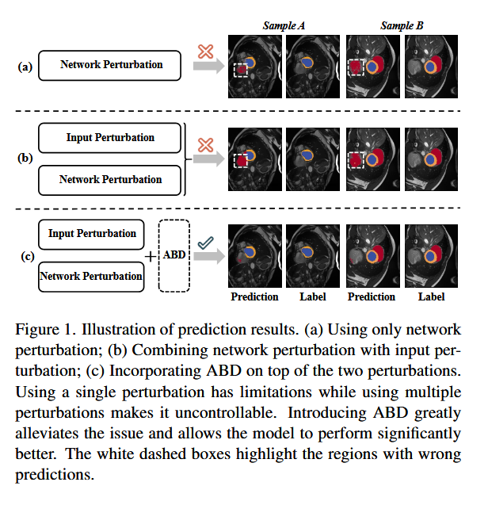
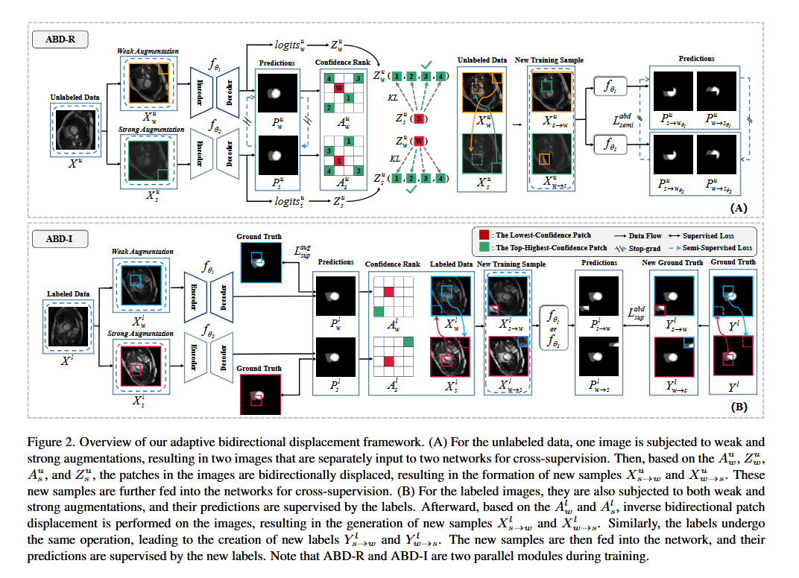
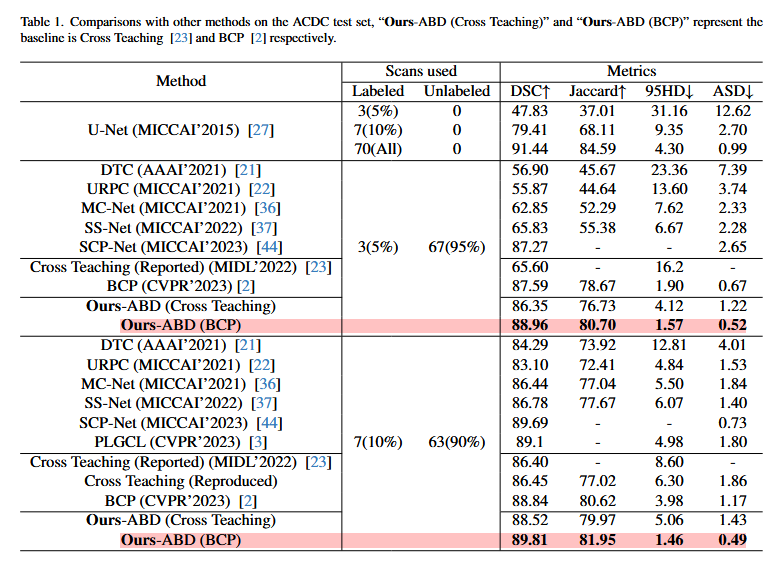
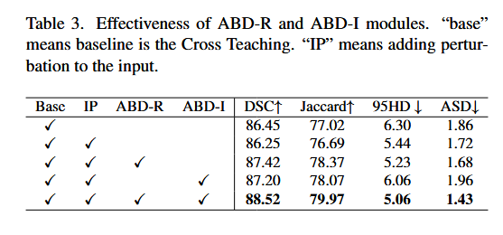
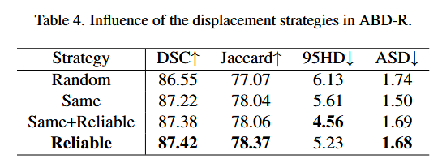

## 摘要
一致性学习是半监督医学图像分割（SSMIS）中处理未标记数据的核心策略，它强制模型在扰动下产生一致的预测。然而，目前大多数方法仅专注于利用特定的单个扰动，只能应对有限的情况，而同时采用多个扰动很难保证一致性学习的质量。在本文中，我们提出了一种自适应双向位移（ABD）方法来解决上述挑战。具体来说，我们首先为未标记数据设计一种基于可靠预测置信度的双向斑块位移，以生成新的样本，该方法可以有效抑制不可控区域，并且仍然保留输入扰动的影响。

同时，为了强制模型学习潜在的不可控内容，对标记图像提出了具有逆置信度的双向位移操作，该操作生成具有更多不可靠信息的样本，以促进模型学习。广泛的实验表明，ABD实现了SSMIS的最新性能，显着改善了不同的基线。源代码可在 [GitHub 仓库](https://github.com/chyupc/ABD) 获取。

---
## 动机
- 一致性学习默认"两个预测虽然不同，但都应该是对的"，所以逼它们一致就能变好。可一旦扰动叠加太猛，两个预测会变成"都错，而且错得一模一样"——这时候再逼它们一致，就等于逼着模型把错误锁死、越学越错。如图所示，图a为单个网络扰动，单特定的单一扰动只能处理有限的情况。图b加了网络扰动，会放大背景的预测的错误。

---
## 架构
为了应对上述挑战，我们提出了SSMIS的自适应双向位移（ABD），如图1（c）所示。具体来说，对于每个未标记的图像，首先应用输入扰动来产生一对输入图像，例如弱增强图像和强增强图像。然后我们根据上述两个扰动图像的预测生成两个置信度矩阵（置信度秩图）。置信度矩阵评估属于不同类别的预测像素的确定性，从而反映模型对不同扰动的可靠性。

然后，对于任何增强图像，其具有最低置信度秩的区域与具有高度置信度分数的输出分布最相似的其他增强图像的区域发生交换（ABD-R）。通过这种方式，新生成的图像可以去除不受控制的区域，并从另一个增强图像中获得互补和近似的语义信息，这确保了模型跨不同扰动的一致预测。同时，为了强制模型学习那些潜在的不可控区域，我们将标记数据的逆置信度合并为额外的自适应双向位移（ABD-I）。

对于任何标记的增强图像，置信度得分最高的图像区域与置信度得分最低的另一张增强图像区域相位移。此操作将加强模型以解决不可控区域。结合这两种策略，我们的方法执行了一种新颖的输入扰动方法，它可以直接应用于现有的一致性学习方法。

简单总结一下：
- 对于无标签数据，弱增强和强增强的两个图像分别通过两个不同的网络生成**两个预测**结果后，将这两个图像的低置信度区域用对方的高置信度区域交换后**均**送入两个网络进行预测（2 $\times$ 2），一共生成4个图像，用两个网络结果互相当做伪标签。
- 对于有标签数据，弱增强和强增强的两个图像分别通过两个不同的网络生成**两个预测**结果后，将这两个图像的高置信度区域用对方的低置信度区域交换后送入两个网络进行预测，用发生同样平移的真实GT当做标签
---

## 与其他模型对比

---

## 消融实验

没懂为什么不是在最终模型的ABD-R上做交换策略的消融实验。

---
## 思考

一种比较有意思的半监督数据增强方式可以值得学习。

---
