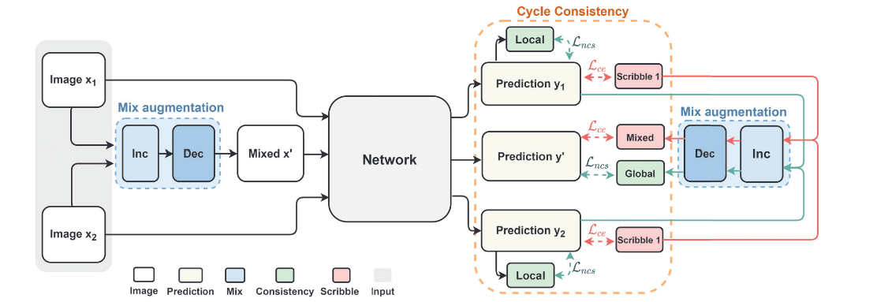
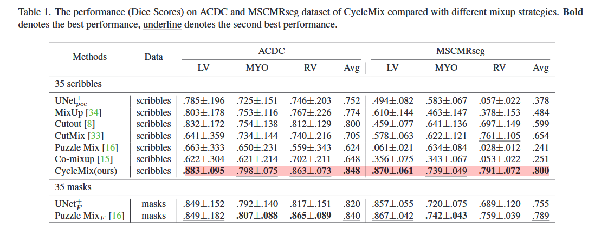
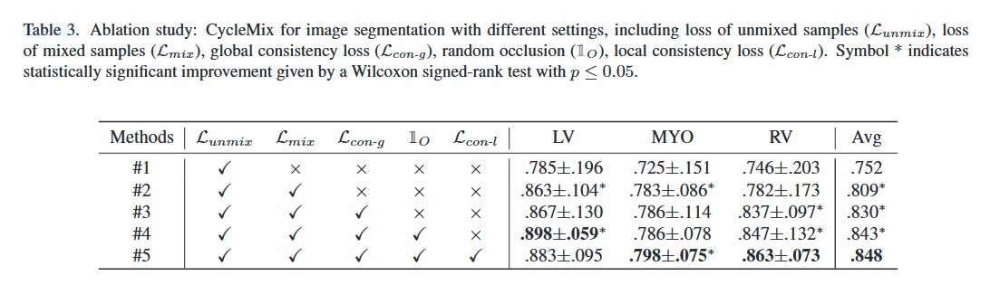

## 摘要
管理大量完全注释的训练数据可能成本很高，尤其是对于医学图像分割任务。
涂鸦是一种较弱的注释形式，在实践中更容易获得，但从涂鸦的有限监督中训练分割模型仍然具有挑战性。

针对这些困难，我们提出了一种基于涂鸦学习的医学图像分割新框架，该框架由混合增强和循环一致性组成，因此被称为循环混合。 

为了增强监督，CycleMix采用混合掩码策略和专用的随机遮挡设计，以执行涂鸦的增量和减量。

对于监督的正则化，CycleMix用一致性损失强化训练目标，以惩罚不一致的分割，从而显着提高分割性能。
在ACDC和MSCMRseg两个开放数据集上的结果表明，所提出的方法取得了令人振奋的性能，显示出与全监督方法相当甚至更好的准确性。

MSCMRseg的代码和专家制作的涂鸦注释可在[Github 仓库](https：//github.com/BWGZK/CycleMix公开获得)。

---
## 架构
为了应对上述挑战，作者提出的架构如下图所示：

主要核心有三个：
- x1和x2原图单独做一次分割预测计算损失函数，通过还需要额外与最大连通域的结果进行交叉熵以约束结果尽量连通。

- x1和x2经过一个掩码策略得到混合图x'然后根据混合标签，做一次分割预测，

- x'通过**随机旋转**的矩形掩码（论文中是32 *32大小）得到x''，与x'的预测结果做全局一致性约束强化训练目标。

### 掩码策略
下面重点讲解作者怎么得到混合策略的：

设两个带有标注的 $d$ 维图像为 $(x_1, y_1), (x_2, y_2)$。由这两个训练数据经传输矩阵得到的混合结果记为 $(x_{12}^m, y_{12}^m)$，其计算方式如下：

$$x_{12}^m = M(x_1, x_2) \text{ 且 } y_{12}^m = M(y_1, y_2)$$

$$M(a_1, a_2) = (1-z) \odot \Pi_1^T a_1 + z \odot \Pi_2^T a_2$$

其中 $M(a_1, a_2)$ 是作用于 $a_1$ 和 $a_2$ 的 mixup 函数；$\Pi_1$ 和 $\Pi_2$ 表示维度为 $d \times d$ 的传输矩阵；$z$ 表示维度为 $d$、取值范围在 $[0, 1]$ 的掩码；$\odot$ 表示逐元素乘法。参数集 $\{\Pi_1, \Pi_2, z\}$ 旨在最大化混合图像的显著性，其计算方式为：

$$\{\Pi_1, \Pi_2, z\} = \underset{\Pi_1, \Pi_2, z}{\arg \max} [(1-z) \odot \Pi_1^T s(x_1) + z \odot \Pi_2^T s(x_2)],$$

其中 $s(x)$ 是图像 $x$ 的显著性，通过取梯度值的 $l_2$ 范数来计算。关于该优化过程，更多细节可参考文献ICML'20 Puzzle mix的论文。

### 全局一致性
全局一致性损失函数基于两个分割结果之间负余弦相似度的对称度量作为全局一致性损失（global consistency loss），

$$ \mathcal{L}_{con\text{-}g} = \frac{1}{2} \left[ \mathcal{L}_{ncs}(p_{12}, q_{12}) + \mathcal{L}_{ncs}(p_{21}, q_{21}) \right] $$

其中，$p_{12} \triangleq (1 - \mathbb{1}_o) \odot M(\hat{y}_1, \hat{y}_2)$ 且 $q_{12} \triangleq S((1 - \mathbb{1}_o) \odot x_{12}^m)$ 分别是混合图像的分割结果加随机掩码与加随机掩码的混合图像分割结果；同理适用于 $p_{21}$ 和 $q_{21}$；$\mathcal{L}_{ncs}(\cdot, \cdot)$ 是负余弦相似度，其定义为：

$$ \mathcal{L}_{ncs}(p, q) = - \frac{p \cdot q}{\|p\|_2 \cdot \|q\|_2} $$

### 局部一致性
对于目标对象，mixup 操作经常导致混合图像中出现结构不连续的现象。这种现象使得分割模型特别难以学习目标对象的形状先验。

利用目标结构在许多医学应用中可以相互连接这一事实，我们提出局部一致性以消除离散结果。对于未混合图像 $x_1$ 和 $x_2$，局部一致性损失 $\mathcal{L}_{con\text{-}l}$ 表述如下：

$$ \mathcal{L}_{con\text{-}l} = \frac{1}{2} \left[ \mathcal{L}_{ncs}(\hat{y}_1, C(\hat{y}_1)) + \mathcal{L}_{ncs}(\hat{y}_2, C(\hat{y}_2)) \right]$$

其中，$C(\cdot)$ 是对分割结果的形态学操作，其输出输入分割中每个非背景类别的最大连通区域。公式 (13) 的目的是最小化分割之间的距离。

最后，训练目标 $\mathcal{L}$ 表述如下：

$$ \mathcal{L} = \underbrace{(\lambda_1 \mathcal{L}_{unmix} + \lambda_2 \mathcal{L}_{mix})}_{sup} + \underbrace{(\lambda_3 \mathcal{L}_{con\text{-}g} + \lambda_4 \mathcal{L}_{con\text{-}l})}_{unsup}, \quad (14) $$

其中 $\lambda_1, \lambda_2, \lambda_3, \lambda_4$ 是用于权衡不同损失组件相对重要性的超参数。

---

## 与其他模型对比

---

## 消融实验
从结果来看，**一致性损失**强化训练目标非常重要。

