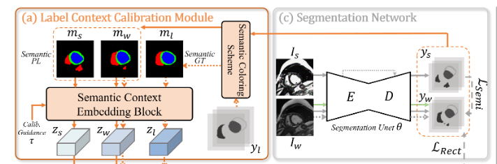
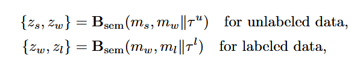
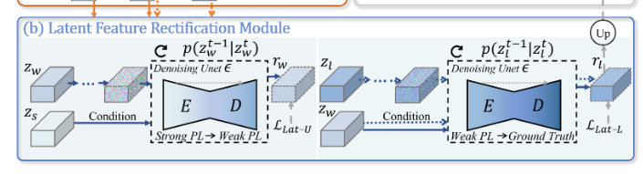
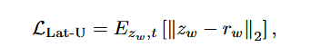
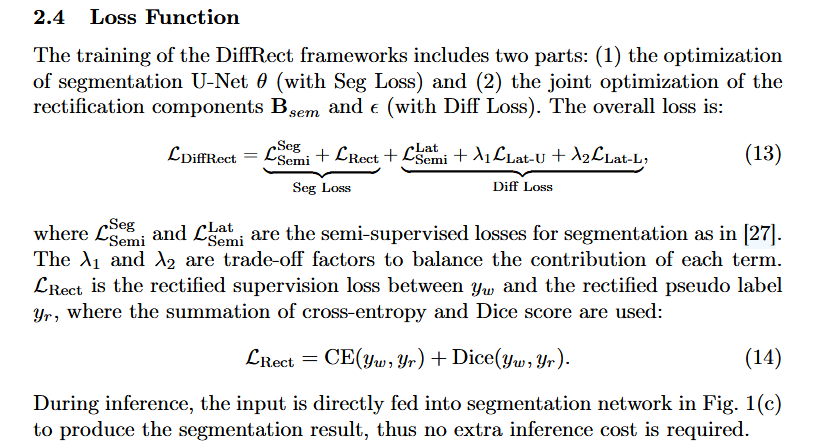
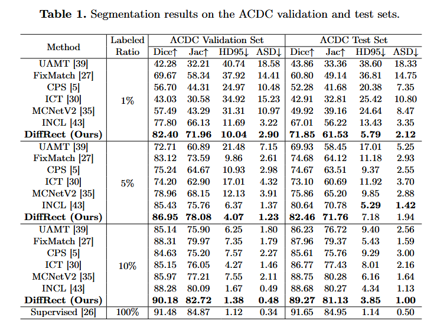
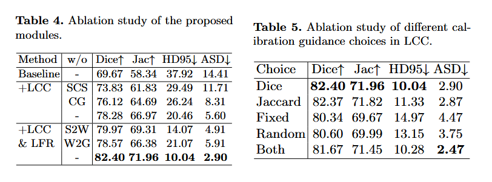

## 摘要
半监督医学图像分割旨在利用有限的注释数据和丰富的未标记数据进行精确分割。然而，现有的半监督方法高度依赖于自生成伪标签的质量，容易出现不正确的监督和确认偏差。同时，它们在捕获潜在空间中的标签分布方面不足，并且遭受对未标记数据的有限泛化。针对这些问题，我们提出了一种用于半监督医学图像分割的潜在扩散标签校正模型（DiffRect）。
DiffRect首先利用标签上下文校准模块（LCC）通过学习伪标签中的类别相关性来校准类之间的偏差关系，然后在潜在空间上应用潜在特征校正模块（LFR）通过潜在扩散来制定和对齐不同级别的伪标签分布。它利用去噪网络来学习从粗到细和从细到精确的连续分布传输。我们在三个公共数据集上评估DiffRect：ACDC、MS-CMRSEG 2019和迪卡侬前列腺。
实验结果证明了DiffRect的有效性，例如，它在ACDC上获得了82.40%的Dice分数，只有1%的标记扫描可用，在Dice上的表现优于以前最先进的4.60%，甚至可以与完全监督的性能相媲美。源代码可在 [GitHub 仓库](https://github.com/CUHK-AIM-Group/DiffRect发布) 获取。

---

## 架构

- 总体架构采用DDPM为基础，分别设计了标签上下文校准模块（LCC）和潜在特征校正模块（LFR）
- 标签上下文校准模块（LCC）：
  
  如图所示，我们编码了强增强和弱增强的标签，使用提出的语义着色方案（SCS）。具体来说，对于包含$C$个不同类的数据集，我们构建了一个由$C$个RGB颜色组成的颜色集$MC$，每种颜色由[0,255]范围内的三个值组成的元组表示。我们最大化每个编码类别之间的颜色差异，以避免语义混淆，即将数据从$H$$\times$$W$$\times$$C$转移到$ H$ $\times$ $W$ $\times$ $3$。

  

  为了使用语义标签进行上下文校准，我们设计了一个语义上下文嵌入块:

  

  其中未标记和标记数据的$τ^u$和$τ^l$值是使用不同质量的one-Hot分割掩码之间的Dice系数计算后进行正弦嵌入编码。

- 对于潜在特征校正模块LFC模块：
  对$z_w$信号进行加噪，然后利用$z_s$和$z_w^t$当做条件进去解噪，最后对输出特征与最开始的特征进行损失函数计算。
  

  

  

- 整体损失函数由以下几个部分构成：
  Unet预测的分割损失，纠正前后的$y_w$损失（为什么只有他进行论文中并没有解释，我认为非常不合理），以及潜空间上的分割损失（论文中也没用提到怎么计算的，我猜测应该是和z的那几个变量有关），最后是diffusion的损失。
- 
- 
## 与其他模型对比

---

## 消融实验
对各个模块，和$τ$的生成进行了消融实验。他这个HD95非常神奇，不知道怎么降低到10的，看他的实验HD95应该基本没怎么优化才对。

---
## 思考

我感觉可能比较有意思的地方是标签上下文校准模块LCC？这个LFR潜在特征校正模块说实话我感觉motivation很奇怪。

---
