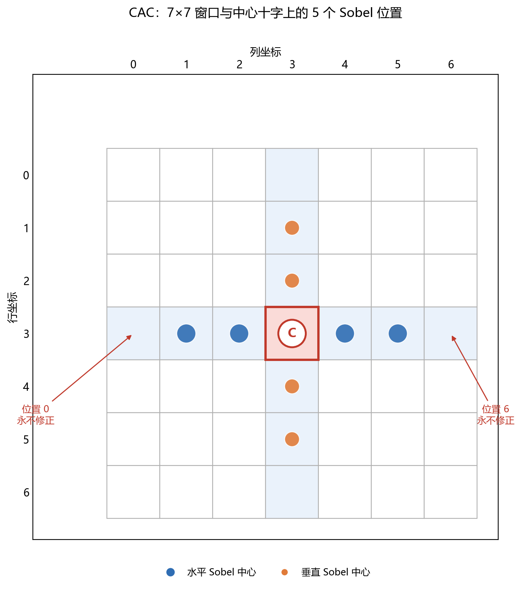

## 为什么需要色差校正（CAC）
镜头对不同波长的光折射率不同。一束白光经过镜头后，R、G、B 的焦点/放大率不完全重合，于是在高反差边缘（树枝对着天空、白底黑字、窗框）附近，R、G、B 三个通道在空间上错开了几个像素。表现出来就是：出现紫边或者绿边，`CAC`要做的，就是把跑偏的 R/B 拉回到 G 的位置。

为什么以 G 为锚？

* 人眼对绿光最敏感，G 的锐度决定了主观清晰度；
Bayer 阵列里 G 的数量是 R/B 的两倍，G 的信噪比最好；
只修 R/B、不动 G，可以最大程度保留亮度和细节。

## 算法实现

### 第一步：计算Sobel梯度

CAC 用于处理窗口的中心行和中心列，计算下图所示特殊点的`Sobel`梯度：

以水平方向，G通道为例，对于第$i$个点，Sobel 梯度满足下式：

$$EG_i = -2G_{3, i - 1} - G_{2, i - 1} - G_{4, i - 1} + 2 G_{3, i + 1} + G_{2, i + 1} + G_{4, i + 1} $$

同理，对于这9个特殊点，我们可以计算各特殊点分别水平和垂直的RGB梯度。（特别的，中心点计算了水平和垂直）

### 第二步：观察中心点的Sobel梯度大小

只看中心位置的 G 梯度：

判断$$ |EG| >  T_{transient}$$

水平触发就修水平，垂直触发就修垂直；没触发的方向不修。

### 第三步：搜索修正区间

以水平修正为例，先根据中心 G 梯度的符号定一个极性：

$$
\sigma =
\begin{cases}
+1, & EG_2 > 0 \\
-1, & EG_2 < 0
\end{cases}
$$

把该方向上 5 个位置的 R/G/B 梯度都乘以 $\sigma$。然后每个位置取三通道最大值：

$$
M_i = \max(\sigma ER_i,\ \sigma EG_i,\ \sigma EB_i)
$$

从中心（$i=2$）向左、右搜索，第一次遇到

$$
M_i < T_{\text{edge}}
$$

的位置，就是瞬态区间的端点。

左边第0列和第6列由于没有计算梯度，默认不满足条件，这样我们可以得到左右边界$L,R$，修复$[L + 1, R - 1]$。

### 第四步：修正色差

对于R、B两个通道分别采取下面的处理方式，设左右端点的色差为 $K_L$、$K_R$，令：

$$
K_{\max} = \max(K_L, K_R), \qquad
K_{\min} = \min(K_L, K_R)
$$

对$[L + 1, R - 1]$区间内每个位置 $j$：

- 超过上限 $K_j > K_{\max}$：

$$
C_{\text{out}}
=
G_j + \frac{K_{\max}\cdot coef1}{1024}
$$

- 低于下限 $K_j < K_{\min}$：

$$
C_{\text{out}}
=
G_j + \frac{K_{\min}\cdot coef1}{1024}
$$

- 在区间内 $K_{\min} \le K_j \le K_{\max}$：

$$
C_{\text{out}}
=
G_j
+
\frac{coef2\cdot(K_{\max}+K_{\min})}{2048}
+
\frac{K_j\cdot coef3}{1024}
$$

最后裁剪到 $[0,255]$。

直观理解：

- `coef1` 控制“超出端点范围的色差要拉回多少”。
  - `coef1=1024`：保留 1.0 倍端点色差；
  - `coef1=0`：直接把色差拉到 0（边缘变灰）。
- `coef2` 控制“两端平均趋势”的贡献。
- `coef3` 控制“当前像素自身色差”保留多少。
  - `coef3=1024`：原样保留当前色差；
  - `coef3=0`：不保留当前色差。

三个系数需要联调：

- `coef1` 过大，可能压不住色差；
- `coef3` 过小，可能把正常颜色也抹掉。

### 第五步：候选合并

同一个像素在窗口滑动过程中，可能被多个窗口、水平/垂直两个方向分别修正，产生多个候选值。RTL 使用 `storeBuffer_r/b` 保存历史候选。

合并规则：

$$
|New - Orig| \ge |Stored - Orig|
\quad\Rightarrow\quad
\text{用 New 更新}
$$

注意，比较基准是**同一个延迟对齐的原始像素 `Orig`**。

中心位置 `[3][3]` 同时属于水平路径和垂直路径。RTL 规定：

> 垂直触发时优先使用垂直候选，否则使用水平候选，然后再与历史候选比较。

容易发现CAC需要大量的**buffer**存储历史数据，如每次滑动时前六行数据的存储，像素历史候选最优值的存储，后面讲解cmodel/vmodel的时候会详细分析。

