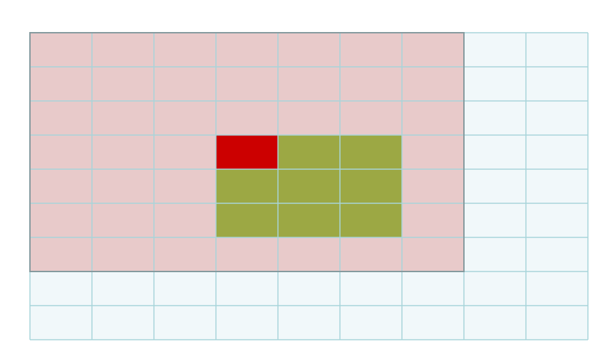

## 为什么需要去马赛克Demosc
**常见的 Bayer 图像传感器在每个像素位置只测量了一种颜色分量，而正常的彩色图像需要在每个位置都有完整的 R、G、B 信息。** 因此，传感器输出的 RAW 数据还不能直接当成完整的 RGB 图像来使用，必须根据相邻像素的采样，估计当前位置缺失的两个颜色分量。


例如Bayer 阵列，就是把这些滤光片按一定规律排列。以 RGGB 为例，局部排列如下：

```text
R   Gr   R   Gr
Gb   B   Gb   B
R   Gr   R   Gr
Gb   B   Gb   B
```

如果只考虑最简单的情况，在一个 R 位置，上下左右恰好都是 G 采样，就可以先用这四个绿色值的平均值估计中心 G。

但是，图像并不总是平滑的，物体边缘正是简单平均容易出错的地方。假设当前位置附近是一条明暗分界线，左侧绿色值大约是 100，右侧绿色值大约是 1000，如果把两边直接平均成 550，而当前位置实际属于暗的一侧，就会人为制造一个不存在的中间亮度，让边缘变模糊。更麻烦的是，R、G、B 的采样位置本来就不同，如果三个通道在边缘附近被错误地混合，还可能产生本来没有的彩色条纹、拉链状边缘或假色。

由于Bayer 阵列中绿色采样占一半，红色和蓝色各占四分之一，因此 G 在空间上拥有更密集的实测数据，适合用来建立局部结构的参考。通常先利用邻域和方向判断补齐周围位置的 G，然后根据局部 `G-R`、`G-B` 色差相对平滑的假设，恢复缺失的 R 和 B。


## 算法实现

### Step1：以当前处理的数据(x, y)为中心取9 $\times$  9 大小的RAW域窗口值

> 若超出边界，则用边界值填充

### Step2：得到(x, y)为中心3 $\times$  3大小的绿色值

> 前面我们已经9 $\times$  9 大小的RAW域窗口值，为了得到中心处的绿色值，我们采用
7 $\times$  7的窗口进行扫描每次可以得到一个绿色中心值，沿着x，y滑动，最终可以得到3 $\times$  3大小的绿色值。示意图如下：



下面讲解对于每个7 $\times$  7的窗口如何得到绿色：

把 `rawWindow[r][c]` 记为 $P_{r,c}$，其中 $r$ 是行下标、$c$ 是列下标，窗口中心为 $P_{3,3}$。

- **1. 左、右方向的水平变化**

对参与计算的三行 \(r\in\{2,3,4\}\)，定义偏左水平变化量 \(L_r\) 和偏右水平变化量 \(R_r\)：

\[
L_r=
\left|P_{r,0}-P_{r,2}\right|
+
\left|P_{r,1}-P_{r,3}\right|
+
\left|P_{r,2}-P_{r,4}\right|
\]

\[
R_r=
\left|P_{r,4}-P_{r,6}\right|
+
\left|P_{r,3}-P_{r,5}\right|
+
\left|P_{r,2}-P_{r,4}\right|
\]

将三行结果按中心行权重加倍的方式合成，就得到左右两个方向的评分：

\[
G_{HL}=L_2+2L_3+L_4+1
\]

\[
G_{HR}=R_2+2R_3+R_4+1
\]

- **2. 上、下方向的垂直变化**

对参与计算的三列 \(c\in\{2,3,4\}\)，定义偏上垂直变化量 \(T_c\) 和偏下垂直变化量 \(D_c\)：

\[
T_c=
\left|P_{0,c}-P_{2,c}\right|
+
\left|P_{1,c}-P_{3,c}\right|
+
\left|P_{2,c}-P_{4,c}\right|
\]

\[
D_c=
\left|P_{4,c}-P_{6,c}\right|
+
\left|P_{3,c}-P_{5,c}\right|
+
\left|P_{2,c}-P_{4,c}\right|
\]

同样按照 \(1:2:1\) 对三列结果进行加权，得到上下方向的评分：

\[
G_{VT}=T_2+2T_3+T_4+1
\]

\[
G_{VD}=D_2+2D_3+D_4+1
\]


最后，整体水平变化量和整体垂直变化量就是：

\[
G_H=G_{HL}+G_{HR},
\qquad
G_V=G_{VT}+G_{VD}
\]

如果该采样点本身就是G，无需进行插值，若是R/B需要利用上述求解得到变化量进行插值，以R为例：

中心的 \(R_0\) 是已经测量到的红色，而中心的 \(G_0\) 是未知量；左右相邻位置的 \(G_{-1}\)、\(G_{+1}\)，以及更远处的 \(G_{-3}\)、\(G_{+3}\)，则都是真实的绿色采样。如果只使用绿色数据，最简单的水平估计就是 \((G_{-1}+G_{+1})/2\)，但这种处理没有考虑中心附近的细节变化。这份代码进一步利用 \(R_0\) 与左右同色红色采样之间的差异，对绿色预测进行修正，生成左、右两个候选：

\[
\widehat G_L
=
\frac{7G_{-1}+G_{-3}}{8}
+
\frac{R_0-R_{-2}}{2}
\]

\[
\widehat G_R
=
\frac{7G_{+1}+G_{+3}}{8}
+
\frac{R_0-R_{+2}}{2}
\]

理解这两个式子时，要把“绿色基准”和“变化补偿”分开。以左候选为例，\((7G_{-1}+G_{-3})/8\) 使用真实绿色建立基础预测，近处绿色占 \(7/8\)，远处绿色占 \(1/8\)；而 \((R_0-R_{-2})/2\) 使用同一个红色通道在两个空间位置上的变化，给这个绿色预测增加一个修正。这里假设在局部区域中，明暗结构往往会同时反映在多个颜色通道上，因此红色的空间变化能够为绿色的变化提供一定参考。如果中心红色高于左边的红色，修正项为正，左候选被提高；如果中心红色更低，修正项为负，候选被降低。这样的补偿有助于保留纯平均容易削弱的局部细节，但在颜色突变或噪声较强时也可能不准确，所以还需要梯度控制它的使用方向。


上、下候选的计算与左右完全对称。为了避免横向坐标与纵向坐标混淆，下面把向上的距离记为 \(T\)，向下的距离记为 \(D\)，那么四方向候选中的另外两个是：

\[
\widehat G_T
=
\frac{7G_{T1}+G_{T3}}{8}
+
\frac{R_0-R_{T2}}{2}
\]

\[
\widehat G_D
=
\frac{7G_{D1}+G_{D3}}{8}
+
\frac{R_0-R_{D2}}{2}
\]

至此，得到了四个对同一未知绿色值的估计：\(\widehat G_L\)、\(\widehat G_R\)、\(\widehat G_T\)、\(\widehat G_D\)，它们的差异来自各自使用了不同的邻域数据；如果附近图像结构平滑、各方向数据一致，候选值通常比较接近，如果存在边缘或纹理，候选值就可能明显不同。因此，接下来的任务不是把四个数无条件平均，而是先在每条轴线上排除明显不可靠的一侧。

使用前面解释的梯度评分，水平方向候选可以写成下面的分段表达式。

\[
\widehat G_h=
\begin{cases}
\widehat G_R, & D_{HL}>3D_{HR},\\[2pt]
\widehat G_L, & D_{HR}>3D_{HL},\\[2pt]
\dfrac{\widehat G_L+\widehat G_R}{2}, & \text{其他情况}.
\end{cases}
\]

这段选择体现的是“更信任变化较小的一侧”。经过这一层，原来的四个候选被整理成水平候选 \(\widehat G_h\) 和垂直候选 \(\widehat G_v\)，但最终采用哪条轴线，还需要比较整体水平变化与整体垂直变化。

令 \(D_H=D_{HL}+D_{HR}\)，\(D_V=D_{VT}+D_{VD}\)，最终绿色估计的选择规则就是：

\[
\boxed{
\widehat G_0=
\begin{cases}
\widehat G_v,
& D_H>3D_V,\\[3pt]
\widehat G_h,
& D_V>3D_H,\\[3pt]
\dfrac{3\widehat G_v+\widehat G_h}{4},
& 2D_H>3D_V\quad\text{且前两项不成立},\\[7pt]
\dfrac{3\widehat G_h+\widehat G_v}{4},
& 2D_V>3D_H\quad\text{且前面条件不成立},\\[7pt]
\dfrac{\widehat G_h+\widehat G_v}{2},
& \text{其他情况}.
\end{cases}
}
\]

当然也有其他方案，这里只是简单介绍。


### Step3：得到R/B颜色

经过Step2，我们得到以采样为中心的 $3 \times 3$ 窗口的绿色，接着是恢复红色和蓝色”的阶段。

**它的核心不是直接平均周围的 R 或 B，而是先估计中心附近的 `G-R` 或 `G-B` 色差，再用中心 G 减去这个色差，恢复缺失的颜色。** 

- 中心是 R 或 B 时：沿两条对角线恢复缺失颜色

若中心是 R ，为了恢复 B，代码分别沿左上—右下这条对角线和右上—左下这条对角线构造色差候选，并判断哪条对角线相对平缓。注意它们比较的是绿色值：

\[
d_1=|G_{\mathrm{左上}}-G_{\mathrm{右下}}|,
\qquad
d_2=|G_{\mathrm{右上}}-G_{\mathrm{左下}}|
\]

某条对角线两端的绿色差异较大，说明沿这条线存在较强的变化，算法就会降低这条线对应色差候选的可信度。


在数学上色差候选可表示为：

\[
v_1=
\frac{
(G_{\mathrm{左上}}-B_{\mathrm{左上}})
+
(G_{\mathrm{右下}}-B_{\mathrm{右下}})
}{2}
\]


\[
v_2=
\frac{
(G_{\mathrm{右上}}-B_{\mathrm{右上}})
+
(G_{\mathrm{左下}}-B_{\mathrm{左下}})
}{2}
\]

有了这两个候选以后，中心色差\(\widehat C_0\)可以写成：

\[
\widehat C_0=
\begin{cases}
v_2, & d_1>3d_2,\\[2pt]
v_1, & d_2>3d_1,\\[2pt]
\dfrac{3v_2+v_1}{4},
& 2d_1>3d_2\ \text{且前两项不成立},\\[7pt]
\dfrac{3v_1+v_2}{4},
& 2d_2>3d_1\ \text{且前面条件不成立},\\[7pt]
\dfrac{v_1+v_2}{2}, & \text{其他情况}.
\end{cases}
\]

该点的绿色减去色差，即可得到该点的R。

- 中心是 G 时：根据 Gr、Gb 的排列分别恢复 R 和 B

先构造水平方向的色差候选 `val_1`，再构造垂直方向的色差候选 `val_2`：

\[
v_h=
\frac{
(G_{\mathrm{左}}-P_{\mathrm{左}})
+
(G_{\mathrm{右}}-P_{\mathrm{右}})
}{2}
\]

\[
v_v=
\frac{
(G_{\mathrm{上}}-P_{\mathrm{上}})
+
(G_{\mathrm{下}}-P_{\mathrm{下}})
}{2}
\]

这里用 \(P\) 表示那些位置上的真实 RAW 值。以Gr为例子，
\[
\boxed{
R_0=G_0-v_h,\qquad B_0=G_0-v_v
\quad\text{（中心为 Gr）}
}
\]

